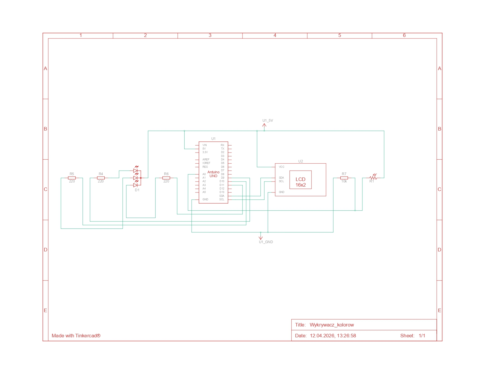
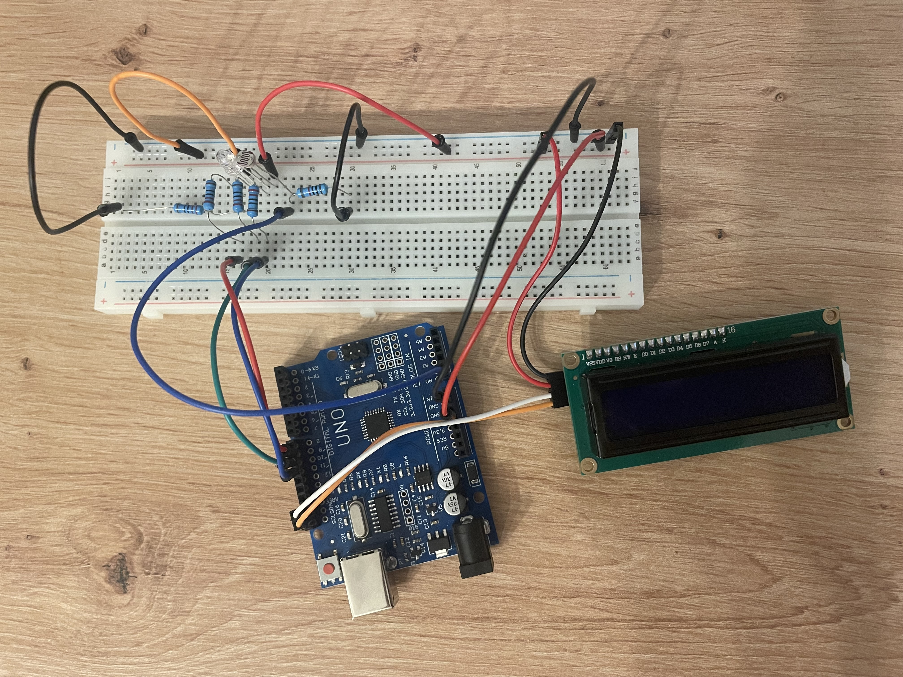

# 🎨 Detektor kolorów RGB + LDR (Arduino)

Projekt systemu do rozpoznawania kolorów z wykorzystaniem diody RGB oraz czujnika światła (LDR).  
Układ analizuje odbite światło dla składowych RGB i porównuje wyniki z wcześniej skalibrowanymi wzorcami.

---

## 📸 Podgląd projektu

### 🔧 Schemat układu


### 🧪 Zbudowany układ


---

## 🎥 Nagranie działania

Poniżej znajduje się krótki film prezentujący działanie układu:

👉 https://www.youtube.com/shorts/8E8dVrAIg4o


## ⚙️ Zasada działania

System działa według następującego algorytmu:

1. Dioda RGB zapala kolejno:
   - czerwony (R)
   - zielony (G)
   - niebieski (B)

2. Czujnik LDR mierzy natężenie odbitego światła.

3. Dla każdej składowej liczona jest średnia z kilku pomiarów (redukcja szumów).

4. Tworzony jest wektor koloru:
```
(R, G, B)
```

5. Wynik porównywany jest z zapisanymi wzorcami kolorów.

6. Wybierany jest kolor o najmniejszej odległości euklidesowej:
```
d = sqrt((R - Rw)^2 + (G - Gw)^2 + (B - Bw)^2)
```

---


## 🔌 Wymagania sprzętowe

- Arduino (UNO / Nano)
- dioda RGB (wspólna anoda)
- czujnik LDR
- rezystor (dzielnik napięcia)
- wyświetlacz LCD I2C (16x2)
- przewody

---

## 🔧 Podłączenie

| Element        | Pin Arduino |
|----------------|------------|
| RGB RED        | 9          |
| RGB GREEN      | 10         |
| RGB BLUE       | 11         |
| LDR            | A0         |
| LCD (I2C)      | SDA / SCL  |


## 🎯 Funkcjonalności

- detekcja kolorów w czasie rzeczywistym  
- filtracja szumów (średnia z pomiarów)  
- wyświetlanie wyniku na LCD  
- łatwa rozbudowa o nowe kolory  

---

## ⚠️ Ograniczenia

- zależność od oświetlenia  
- wymagana kalibracja  
- ograniczona dokładność LDR  

---


## 👨‍💻 Autor

Michał Dolczewski


